<p align="center">
  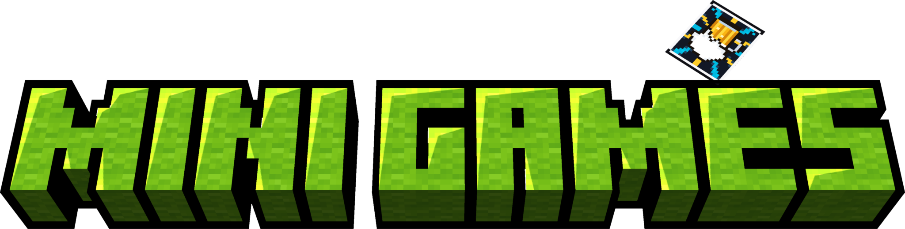
</p>

<p align="center">
  <strong>Wager your emeralds, play with cards like never before, and test your luck against the Gambler.</strong>
</p>

<p align="center">
  
  
  
  <br>
  <a href="https://github.com/birinder-dev/Mini-Games/releases"></a>
  <a href="https://www.curseforge.com/minecraft/mc-mods/fun-mini-games"></a>
</p>

---

## Overview

Mini-Games introduces an authentic tavern card gambling experience into Minecraft Fabric 1.21.1. Pull up a stool, wager emeralds on an interactive table against the Gambler NPC, and handle 3D cards that can be fanned in hand, placed flat onto surfaces, or thrown across the room.

<p align="center">
  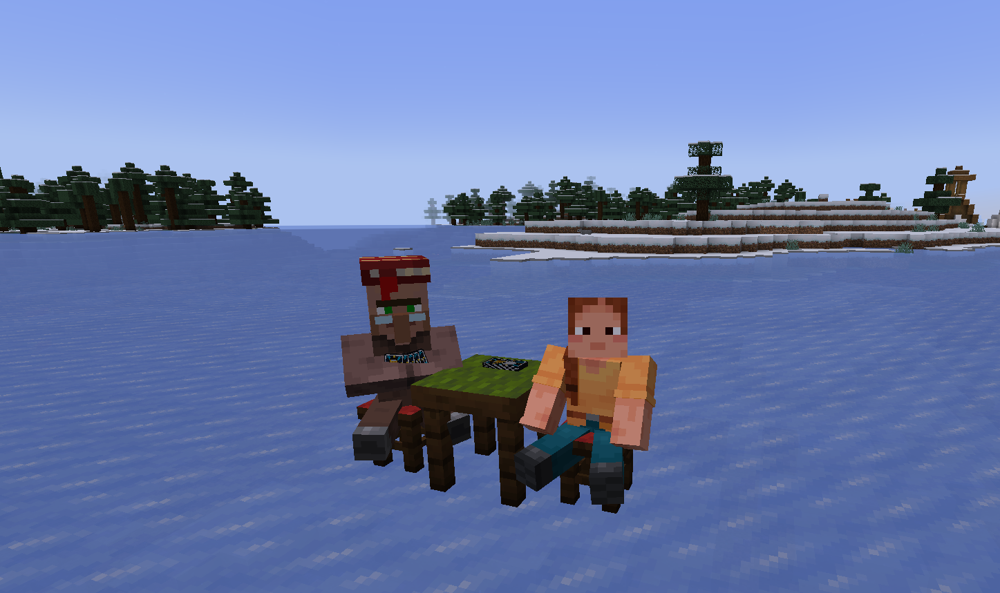
  <br>
  <em>The Gambler seated at the table ready for a match.</em>
</p>

---

# Tavern Gambling Table

### Gambler & Furniture

The Gambler is a custom librarian villager variant programmed with autonomous seating AI that actively searches for nearby stools. For a match to function, the player must sit on the stool directly opposite to the Gambler's stool, with both stools placed immediately adjacent to the Gambling Table block. Once seated, right-clicking either the Gambling Table or the Gambler opens the wagering menu to initiate the game and launch the table HUD.

<p align="center">
  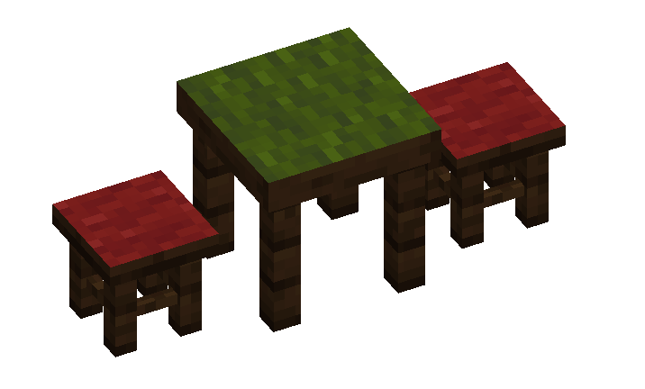
  <br>
  <em>Stool alignment: two adjacent stools positioned directly across from each other.</em>
</p>

### Playing Mechanism & Table HUD

The gambling minigame operates through three dedicated screen tabs: Rules, Advanced Configuration, and the Game itself.

#### 1. Rules

Matches are contested through sequential card reveals against the Gambler. Each round, both participants place one card on the table. Every suit carries an specific win condition, with Sword cards taking absolute priority over Shield cards regardless of numeric value. When both cards are Swords, the higher number cuts down the opponent and takes the point.

<p align="center">
  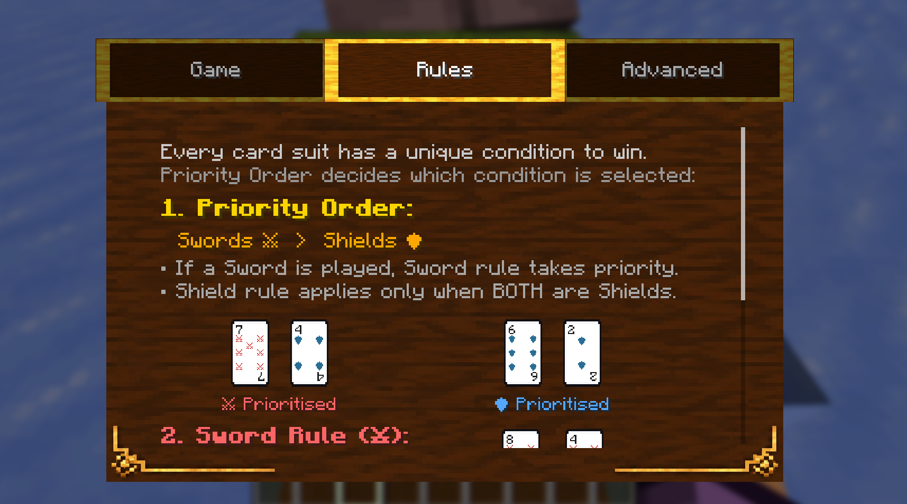
  <br>
  <em>Rules Page 1: Suit priority hierarchy and Sword combat resolution.</em>
</p>

When both played cards are Shields, the rule inverts: the lowest numeric value parries the heavier strike and wins the round. If both participants reveal cards with the exact same suit and identical numeric value, the round results in a tie and both sides draw replacement cards.

<p align="center">
  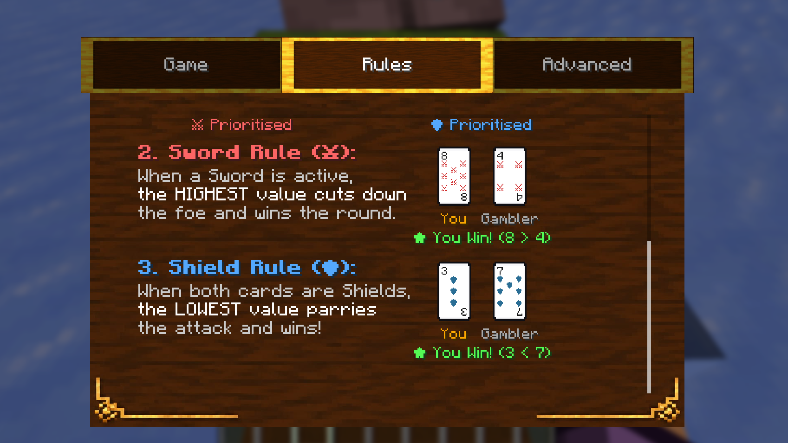
  <br>
  <em>Rules Page 2: Shield mechanics.</em>
</p>

#### 2. Advanced Settings

The Advanced tab configures match parameters before wagering. Players can adjust the Gambler's AI difficulty between Easy, Medium, and Hard. The emerald block texture on this tab was directly inspired by SevTech Ages.

<p align="center">
  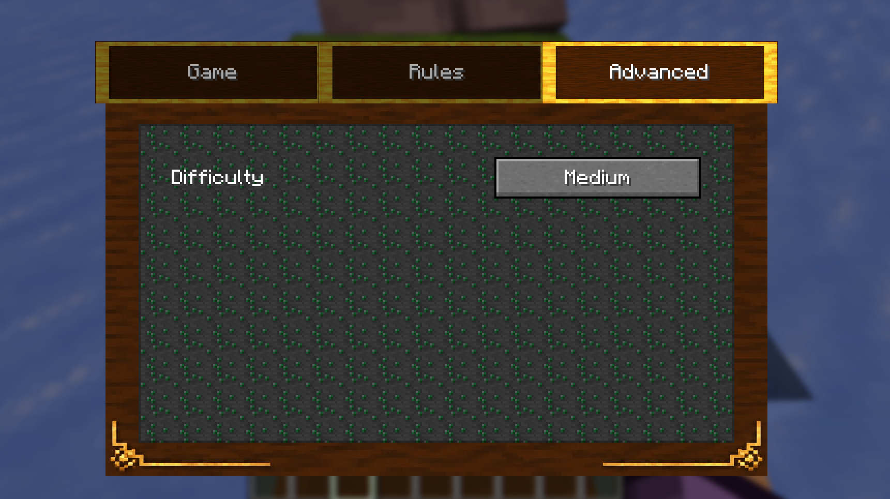
  <br>
  <em>Advanced menu featuring the SevTech-inspired emerald texture in background.</em>
</p>

#### 3. Game Table

The primary Game tab provides a full view of your preferences before starting game, adjust the match length between 3, 5, 7, or 9 rounds, select the emerald wager, and view the confirmed wager amount before the first card is laid down.

<p align="center">
  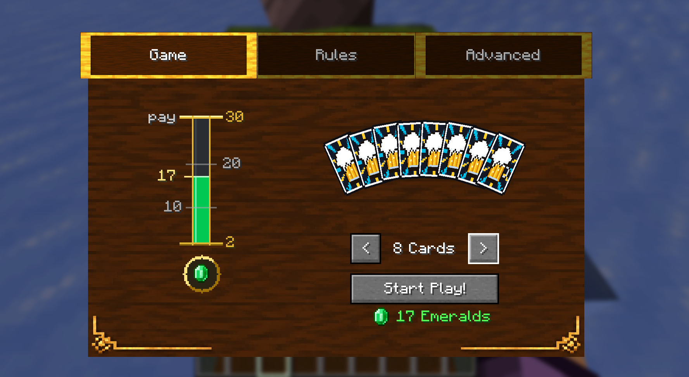
  <br>
  <em>Game tab displaying live hand count and match stakes.</em>
</p>

#### 4. In-Game HUD & Table Deck Pile

Once a match begins, an in-game HUD displays real-time round counts, your current score against the Gambler, and the active emerald wager. While outside of an active game, players can right-click the deck pile resting on top of the gambling table to retrieve fresh cards into their inventory. Winning a match awards double the wagered emeralds (`2 * bet`) directly into your inventory, while losing forfeits the pot to the Gambler.

<p align="center">
  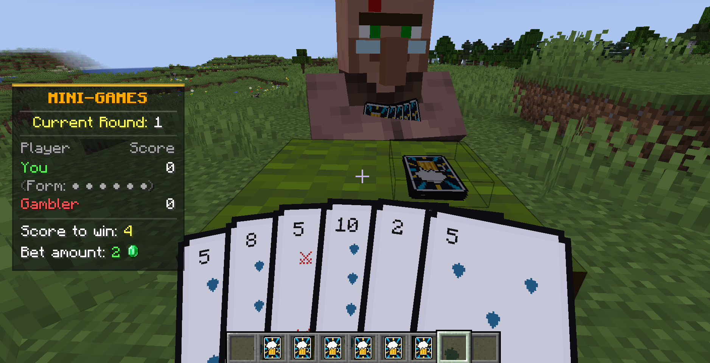
  <br>
  <em>Real-time match HUD tracking round progress.</em>
</p>

---

# Throwable Cards

Holding Tavern Cards in your inventory while outside of a table game and pressing Shift + Right-Click transitions you into the card state, dynamically fanning out your deck in full 3D perspective across your hand. Pressing Shift + Right-Click again exits the state and returns your hotbar to normal.

<p align="center">
  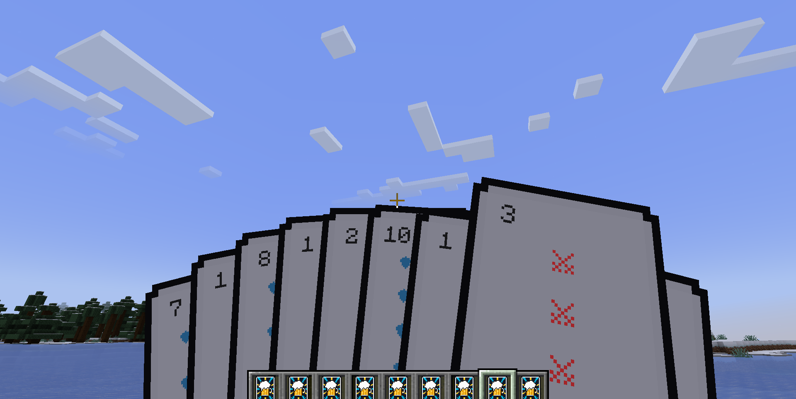
  <br>
  <em>3D deck fanning toggled via Shift + Right-Click.</em>
</p>

While inside the card state, holding Right-Click charges up throw velocity before releasing a high-speed 3D projectile into the air. Note that thrown cards currently do not deal damage.

<p align="center">
  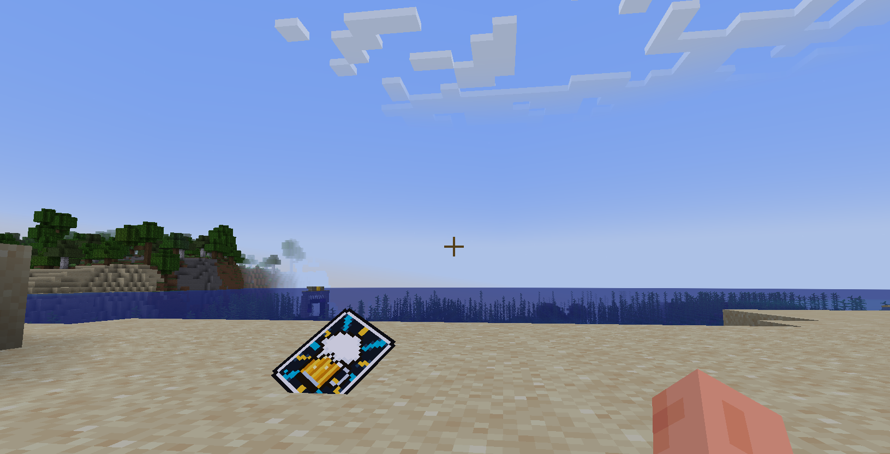
  <br>
  <em>Thrown Card lying on ground.</em>
</p>

Tapping Right-Click directly onto any block face places the card flat against the surface as a decorative item.

<p align="center">
  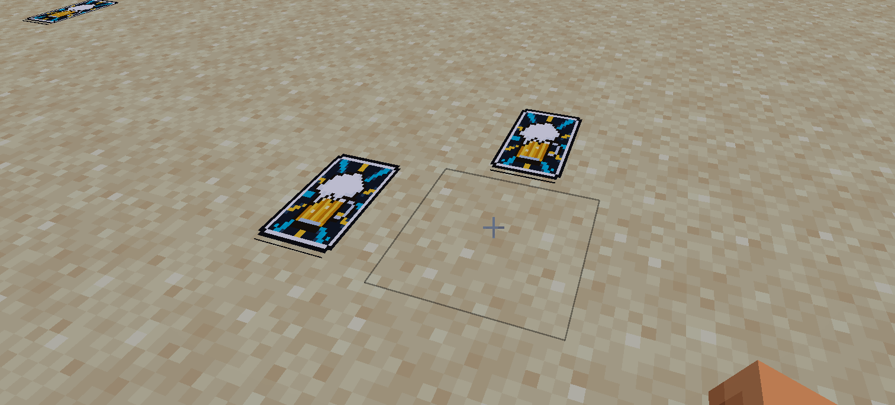
  <br>
  <em>Cards placed flat against world surfaces with a single right-click tap.</em>
</p>

---

# Server Config Features

Server administrators can inspect and modify runtime configurations in-game or through the console using `/minigames` or `/minigames help`.

The base command `/minigames config` supports the following management subcommands:

`/minigames get [option]` checks the current runtime value of any setting.

`/minigames set [option] [val]` changes configuration values on the fly without requiring a server reboot.

`/minigames reload` reloads all values from the configuration file on disk.

`/minigames reset` restores all configuration options back to factory defaults.

The available configuration options are:

`despawn <seconds>` sets the time before placed or thrown cards despawn, or -1 to never despawn.

`damage <amount>` configures the damage dealt by thrown card projectiles.

`pickup <true/false>` toggles whether thrown cards can be retrieved from blocks.

`gambler <true/false>` enables or disables Gambler NPC spawning behavior.

`crafting <true/false>` enables or disables survival recipes for tables, stools, and cards.

`maxcards <1-9>` limits the maximum cards allowed per hand in gambling matches.

<p align="center">
  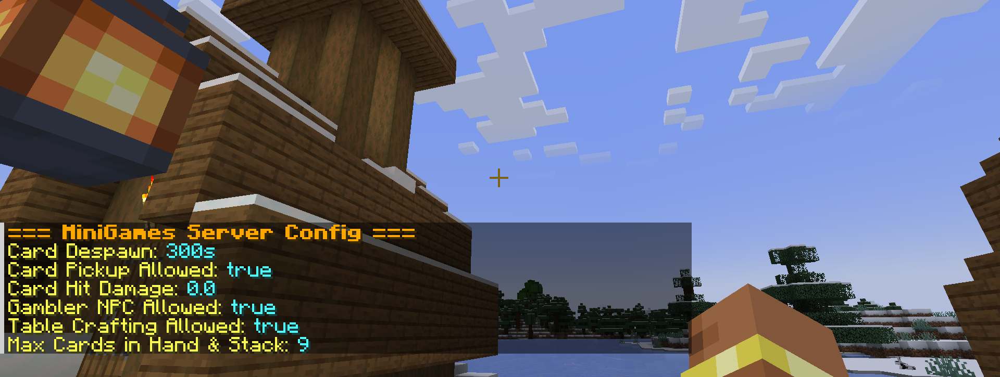
  <br>
  <em>In-game output listing active server settings.</em>
</p>

<p align="center">
  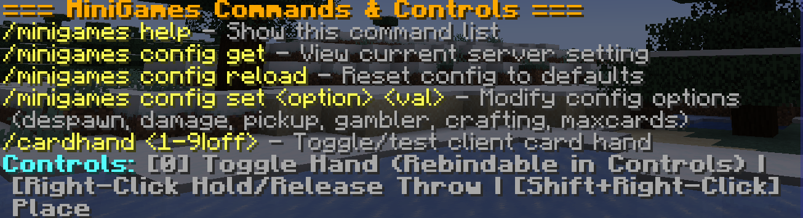
  <br>
  <em>Modifying server configuration parameters via chat commands.</em>
</p>

---

# Creative Tab Addition

A dedicated Mini Games tab has been registered to the creative menu on Page 1 (slot 0) for rapid access to all mod items, furniture blocks, and spawn eggs, represented by a custom 3D Tavern Card icon.

<p align="center">
  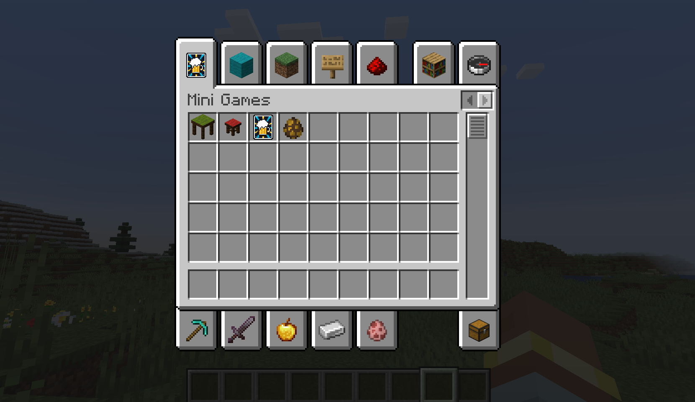
  <br>
  <em>The dedicated Mini Games creative tab positioned on Page 1.</em>
</p>

---

## Quick Controls

| Action | Condition | Control | Description |
| :--- | :--- | :--- | :--- |
| **Sit on Stool** | Free / Standing | `Right-Click` on Stool | Mounts the stool facing the table. |
| **Start Game & HUD** | Seated on stool opposite Gambler | `Right-Click` Table or Gambler | Opens wagering menu to configure match and start table HUD. |
| **Play Table Card** | Active Table Game | `Right-Click` with Card in Hand | Plays your selected card onto the gambling table. |
| **Enter / Exit Card State** | Not in table game | `Hold Shift + Right-Click` with Card | Fans out 3D cards in hand. Repeat to exit back to normal hotbar. |
| **Place Card Flat** | Inside Card State | `Tap Right-Click` on Block Surface | Places the card flat against floors, walls, or tables. |
| **Throw Card Projectile** | Inside Card State | `Hold Right-Click` (> 1 sec) | Charges throw power; release to flick the card as a 3D projectile. |

---

## Crafting Recipes

All three core items can be crafted in survival mode and unlock in the Recipe Book upon collecting their ingredients.

### Gambling Stool
Shaped crafting recipe yielding 1 Gambling Stool:

```
[       ] [ Dark Oak Slab ] [       ]
[       ] [     Stick     ] [       ]
[ Stick ] [               ] [ Stick ]
```

Ingredients: 1 Dark Oak Slab and 3 Sticks.

### Gambling Table
Shaped crafting recipe yielding 1 Gambling Table:

```
[ Dark Oak Slab   ] [ Dark Oak Slab ] [ Dark Oak Slab   ]
[ Dark Oak Planks ] [ Green Carpet  ] [ Dark Oak Planks ]
[ Dark Oak Planks ] [               ] [ Dark Oak Planks ]
```

Ingredients: 3 Dark Oak Slabs, 4 Dark Oak Planks, and 1 Green Carpet.

### Tavern Card
Shapeless crafting recipe yielding 4 Tavern Cards:

```
[ Paper ] + [ Leather ] + [ Gold Nugget ]
```

Ingredients: 1 Paper, 1 Leather, and 1 Gold Nugget placed anywhere in the crafting grid.

---

## Installation

### 1. Playing Within Minecraft (Standard Setup)

For normal survival or modpack playthroughs, download the compiled mod `.jar` from either release channel:

* **GitHub Releases**: [Mini-Games Releases](https://github.com/birinder-dev/Mini-Games/releases)
* **CurseForge**: [Fun Mini-Games on CurseForge](https://www.curseforge.com/minecraft/mc-mods/fun-mini-games)

Requirements:
* **Minecraft**: `1.21.1`
* **Fabric Loader**: `0.19.5+`
* **Fabric API**: Required

Place `mini-games.jar` into your `.minecraft/mods` directory, launch the game, and you are ready to play.

### 2. Testing Without Minecraft (Dev Environment)

To test the mod directly from the source repository in the pre-built showcase room:

```powershell
git clone https://github.com/birinder-dev/Mini-Games.git
cd Mini-Games
.\gradlew runClient --args="--quickPlaySingleplayer DemoWorld"
```

If testing in an existing singleplayer world, run `/function tavern:setup` in chat to automatically generate the showcase tavern room.

> **Performance Note**: Running through `runClient` incurs background development and debugging overhead that consumes more memory and CPU for lower visual framerates. For actual survival gameplay, the compiled `.jar` above is preferred.

---

## 📌 Supported Versions

* **Minecraft**: `1.21.1`
* **Mod Loader**: `Fabric Loader 0.19.5+`

Currently, Mini-Games is built and maintained exclusively for **Minecraft 1.21.1 Fabric**. Support for other versions or alternative mod loaders will be announced here as development continues.

