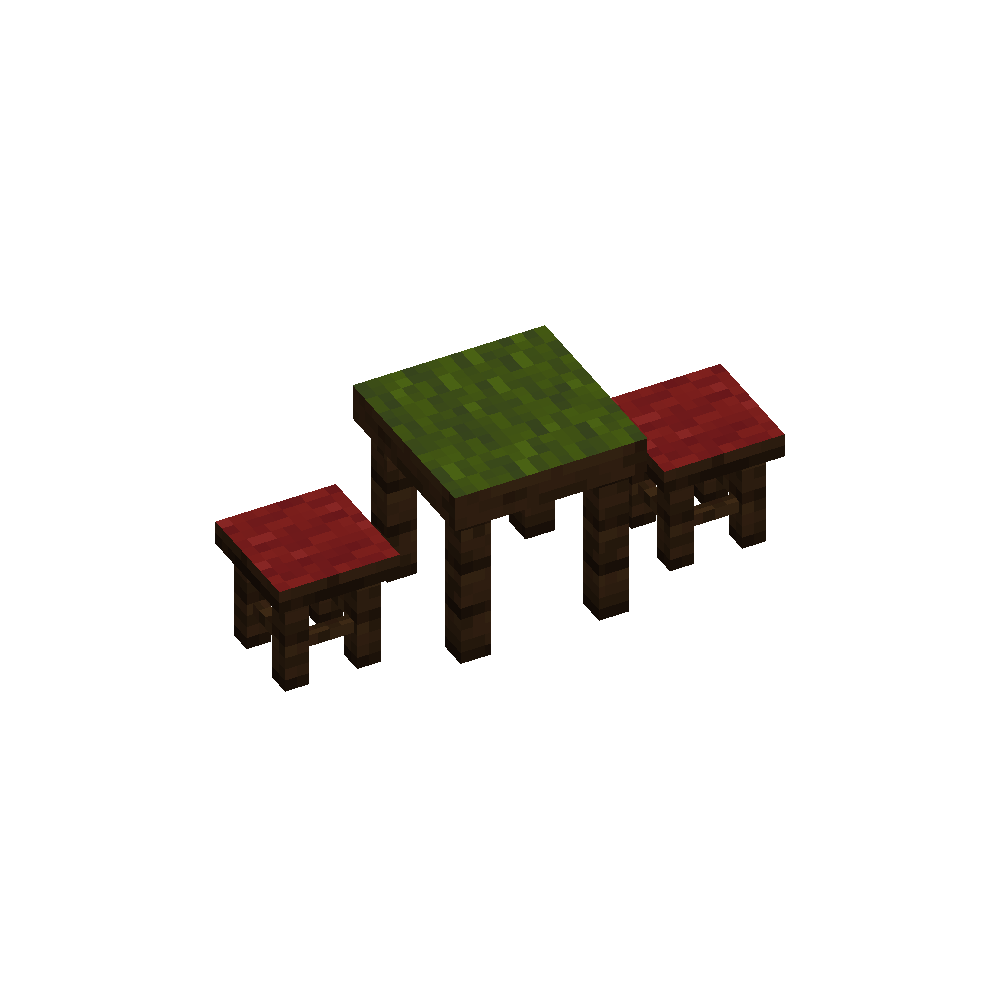
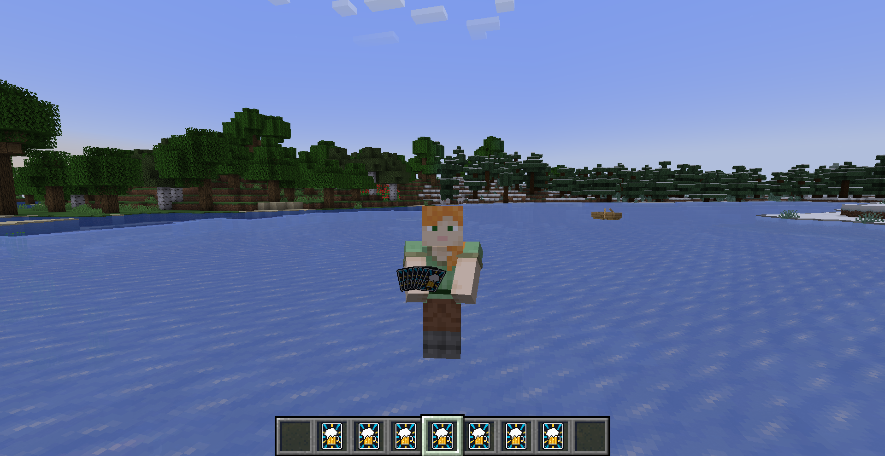

<p align="center">
  
</p>

<p align="center">
  <strong>Wager your emeralds, master 3D card physics, and test your luck against the Gambler.</strong>
</p>

<p align="center">
  
  
  
  <a href="https://codespaces.new/birinder-dev/Mini-Games">
    
  </a>
</p>

---

## 🎲 Overview

**Mini-Games** brings an authentic, high-stakes tavern card gambling experience to Minecraft Fabric 1.21.1. Pull up a stool, challenge the local Gambler NPC, wager your emeralds on an interactive gambling table, and throw or place fully rendered 3D cards in the world.

<p align="center">
  
</p>

---

## ✨ Key Features

### 🃏 1. 3D Tavern Cards & Physics
<p align="center">
  
</p>

* **Tap Right-Click (< 1s)**: Instantly places cards flat on block surfaces (tables, floors, walls).
* **Hold Right-Click (> 1s)**: Charges throw power with release flick sounds, launching the card as a high-speed 3D projectile.
* **Shift + Right-Click**: Fans out your 3D deck dynamically across your hotbar slots, or collapses it back.
* **Dynamic Pip Generator**: Every card procedurally renders accurate numeric pips and suit icons with crisp pixel alignment.

---

### 💰 2. The Gambling Table & Pot Economy
* **Interactive Table Screen**: High-DPI custom UI featuring an animated emerald bet slider, card count configuration, and AI difficulty modes.
* **Double Emerald Payout (2× Pot)**: Winning a match awards double your wager (`2 * matchBet`) accompanied by a victory fanfare sound.
* **Tie Refunds**: Matching scores return your original bet in full.
* **Forfeit Protection**: Standing up or leaving mid-game forfeits your bet to prevent cheating.
* **Real-Time Score HUD**: Live overlay tracking rounds, player score, gambler score, and current pot wager.

---

### 🧑‍💼 3. Gambler NPC & Smart Seating
<p align="center">
  
</p>

* **Unique NPC Design**: Custom librarian villager variant outfitted with an authentic stylish jacket layer.
* **Autonomous Seating AI**: The Gambler actively seeks out adjacent gambling stools, sits down, and challenges nearby players to matches.
* **Interactive Stools**: Right-click to sit down at the table. Dismounting or dying cleans up invisible seat entities instantly.

---

## 🎮 Controls & Quick Reference

| Action | Control | Description |
| :--- | :--- | :--- |
| **Sit at Table** | `Right-Click` on Stool | Mounts the stool facing the table. |
| **Open Game Menu** | `Right-Click` on Gambling Table | Opens the wager, round count, and difficulty GUI. |
| **Play Table Card** | `Right-Click` with Card in Hand | Plays your selected card onto the gambling table surface. |
| **Place Card in World** | `Tap Right-Click` (< 1 sec) | Places the card flat on any block face. |
| **Throw Card Projectile** | `Hold Right-Click` (> 1 sec) | Charges throw power; release to flick the card into the air. |
| **Fan Out / Collapse Deck** | `Shift + Right-Click` | Toggles the 3D card hand fanning across the hotbar slots. |

---

## 🚀 How to Play & Test

### Option A: Local Quick Play (Instant Test)
Skip all menu screens and launch directly into the pre-built tavern chamber:
```powershell
.\gradlew runClient --args="--quickPlaySingleplayer DemoWorld"
```

### Option B: 1-Click Cloud Demo (GitHub Codespaces)
Click the badge below to spin up a playable browser demo on GitHub's free cloud quota:

[](https://codespaces.new/birinder-dev/Mini-Games)

---

## 🛠️ Requirements & Setup

* **Minecraft**: `1.21.1`
* **Fabric Loader**: `0.16.0+`
* **Fabric API**: Included / Required
* **Java**: `21`

---

## 📜 License
Developed for the Minecraft community. All custom textures, code, and models are open for extension.
